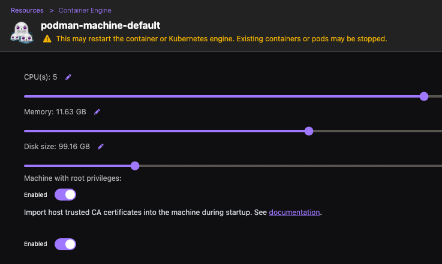
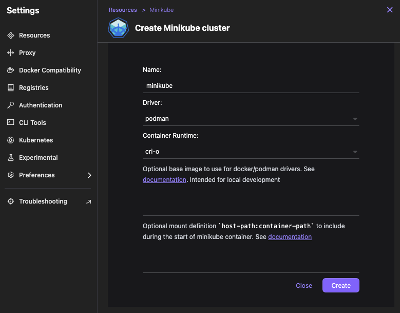

# Setup

Using [Podman Desktop](https://podman-desktop.io/) to provide docker containers with Kubernetes integration.

* Docker Compatibility Enabled
* Docker Compatibility >> Docker Preferences -- make sure that "System socket status" is _podman is listening_
* Docker Compatibility >> Docker Cli: Context -- make sure set to _default (unix://var/run/docker.sock)_
* Extensions:
  * Added:
    - Minikube
    - PostgreSQL
  * Bundled:
    - Docker extension
    - Kind extension
    - Kube Context extension
    - kubectl CLI extension
    - Lima extension
    - Podman extension
    - Podman Docker Context extension
    - Registries extension

Create a new Podman Machine via Settings >> Resources >> Podman "Create new…":

Once there is a Podman Machine running, create a Kubernetes engine using the Minikube extension.

